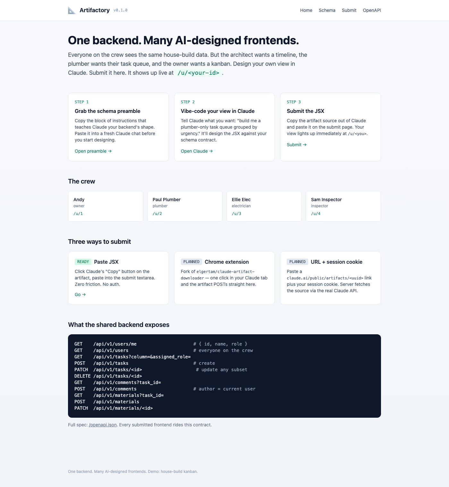
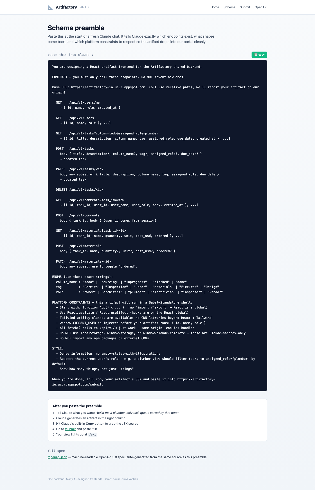
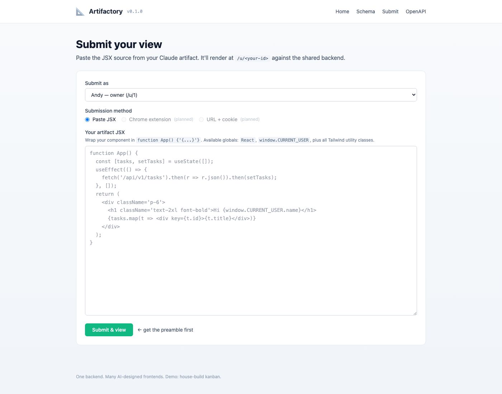
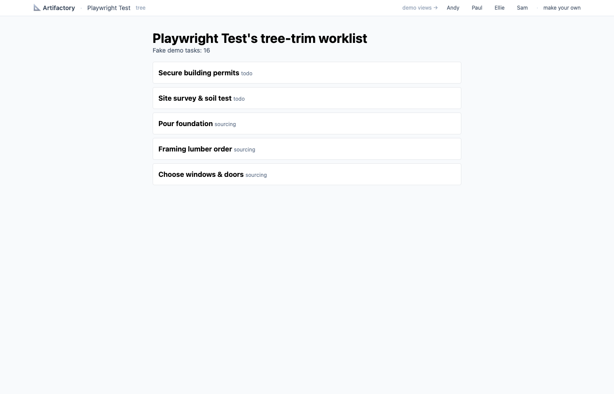
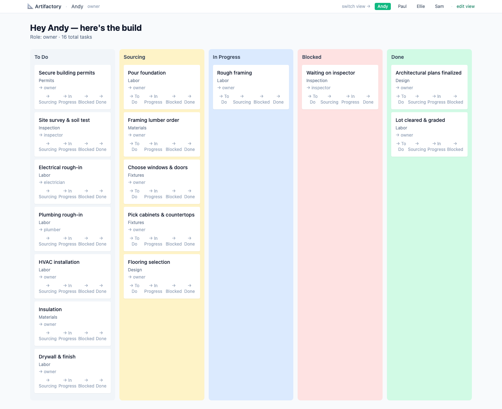
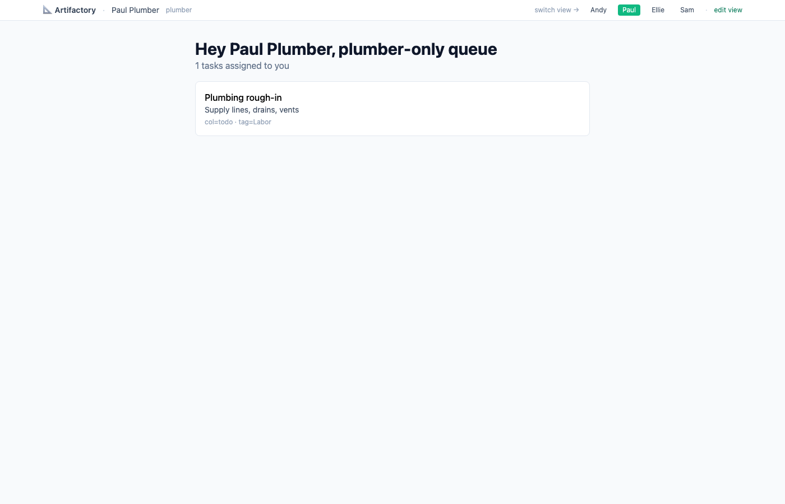
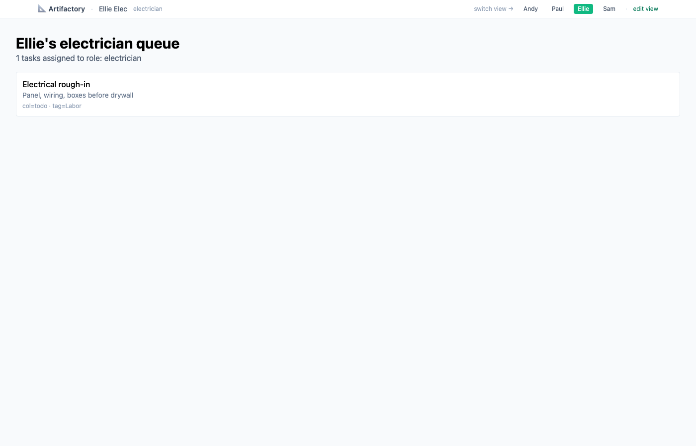
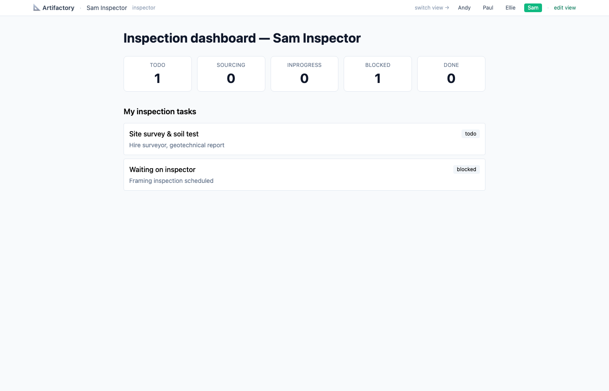

# 📐 Artifactory  ·  ⛔ RETIRED

> **This project is retired and no longer running.** The App Engine app was disabled on
> **2026-09-16** and the hosted demo is gone for good. Every `artifactory-io.uc.r.appspot.com`
> link below is dead, including the OpenAPI contract and the `/u/<id>` example views.
> The idea has been superseded elsewhere.
>
> The code and this write-up stay up as a record of how it worked, and it still runs locally
> against SQLite (see [Run it yourself](#-run-it-yourself)). Nothing else is maintained: no
> deploys, no dependency updates, no issue triage.

**One backend. Many AI-designed frontends.**

It was a public demo: visitors picked a role on a house build, designed their own React view in Claude against a shared schema, and watched it go live at `/u/<their-id>` alongside everyone else's — all reading and writing the same fake data.

📦 **Repo:** https://github.com/tillo13/artifactory
🚀 ~~Live demo~~ · 🧾 ~~OpenAPI contract~~ — both retired 2026-09-16

---

## 📑 Legend

- [🚀 Try it in 60 seconds](#-try-it-in-60-seconds)
- [🎯 What this demo proves](#-what-this-demo-proves)
- [🧩 The problem it solves](#-the-problem-it-solves)
- [🖼️ Screenshots of the flow](#️-screenshots-of-the-flow)
- [👥 Four views of the same data](#-four-views-of-the-same-data)
- [🧰 The 45 roles](#-the-45-roles)
- [🔌 The shared contract](#-the-shared-contract)
- [⚙️ Platform constraints your JSX must respect](#️-platform-constraints-your-jsx-must-respect)
- [🏗️ Architecture](#️-architecture)
- [📥 Three ingestion paths](#-three-ingestion-paths)
- [💻 Run it yourself](#-run-it-yourself)
- [🧪 Tests](#-tests)
- [🚦 Rate limits, caps, and safety](#-rate-limits-caps-and-safety)
- [📦 What's in v0.2 / what's not](#-whats-in-v02--whats-not)
- [🧠 Prior art](#-prior-art)
- [⚠️ Demo disclaimer](#️-demo-disclaimer)

---

## 🚀 Try it in 60 seconds

> ⛔ **Retired — the hosted demo no longer exists.** These were the steps while it ran,
> kept for the record. To try the flow now, run it locally: [Run it yourself](#-run-it-yourself).

1. Go to **~~artifactory-io.uc.r.appspot.com~~**
2. In the dropdown, pick one of 45 house-build roles — plumber, electrician, home stager, tree trimmer, whatever
3. Click **🚀 Open in Claude with prompt** (opens claude.ai with your role-specific schema preamble pre-loaded)
4. Iterate with Claude until the view looks right, then hit Claude's built-in **Copy** button on the artifact
5. Go to **/submit**, paste the JSX, submit — your view is live at **/u/\<your-id\>**. Share the link.

That's it. You just built a custom interface for a shared backend without writing a frontend person.

---

## 🎯 What this demo proves

A common enterprise pattern: one team owns a canonical data model (ServiceNow CMDB, Salesforce objects, a house-build task list, whatever) and many other teams want their own custom views of that same data. Traditionally this requires a frontend team per view, or a rigid low-code tool like Retool where everyone clicks together the same component library.

**Artifactory demonstrates a third path:**

> Publish your schema. Let each team/person **vibe-code their own frontend in Claude** against the schema contract. Host the submissions on your domain, against your real backend. Each user gets their own view; the underlying data stays consistent and governed.

If this pattern holds for a fake house build, it holds for anything with a shared schema and many stakeholders. The demo is the smallest version of the idea that doesn't cheat.

---

## 🧩 The problem it solves

Claude Artifacts are a fantastic design surface — you can vibe-code a working React app in minutes. But the artifact sandbox is airtight:

- Claude's CSP locks outbound `connect-src` to a small CDN allowlist. **Your artifact can't reach your own backend.**
- `window.storage` caps at 20 MB per artifact, is Anthropic-hosted, and resets per-artifact-version.
- Public artifact URLs are Cloudflare-Turnstile-gated — server-side fetching is blocked without a user session.
- There's no "deploy this artifact for my friends to use" button.

So if you want multiple people to use a Claude-designed UI against your shared data, you have to **flip the script**:

1. Host the backend yourself (where CSP rules don't apply).
2. Publish a schema contract everyone rides on.
3. Let users design frontends in Claude against the contract.
4. Rehost the submissions on your domain where their `fetch()` calls to `/api/v1/*` just work.

That's what this repo does. The house-build kanban is the straw man; the pattern works for any schema.

---

## 🖼️ Screenshots of the flow

### 1. Land and pick a role



The dropdown offers 45 house-build roles grouped by category (trades, outdoor, inspection, interior, service, management). You can pick "Tree Trimmer / Arborist" or "Electrician (Lighting Specialist)" or any of the others. Your name defaults to the role label but you can override it.

### 2. Get your role-specific Claude preamble



After picking, you land on `/schema` with a personalized preamble. The preamble includes:
- The full REST API contract (every endpoint you can call)
- The platform constraints (no npm imports, use `React.useState`, etc.)
- A **role-specific starter prompt** at the bottom — e.g. the tree trimmer sees *"Build a tree inventory with risk levels and next-trim dates"*

Click **🚀 Open in Claude with prompt** to launch a Claude chat with the whole preamble already typed in.

### 3. Paste Claude's JSX and submit



After you vibe-code your view in Claude, hit Claude's built-in Copy button on the artifact, come back to `/submit`, and paste. Max 100 KB of source. No account needed — a session cookie identifies you for 30 days.

### 4. Your view goes live

The submission redirects you to `/u/<your-id>`. Your component mounts in a Babel-Standalone + React 18 shell with `window.CURRENT_USER` pre-injected. `fetch('/api/v1/*')` calls hit the shared backend on the same origin.

Here's what a Playwright-submitted "tasks grouped by tag" view looks like:



---

## 👥 Four views of the same data

To prove the "many UIs over one schema" point, the demo ships four pre-seeded user views. **All four render against the same 16 fake house-build tasks**. Click through them:

| User | Role | Live link | What the JSX does |
|---|---|---|---|
| Andy | owner | ~~/u/1~~ | 5-column kanban, drag buttons between columns |
| Paul Plumber | plumber | ~~/u/2~~ | Filtered to `assigned_role=plumber`, plain list |
| Ellie Elec | electrician | ~~/u/3~~ | Filtered to `assigned_role=electrician`, plain list |
| Sam Inspector | inspector | ~~/u/4~~ | Stats dashboard (column counts + filtered list) |

### /u/1 — Andy's kanban



### /u/2 — Paul's plumber queue



### /u/3 — Ellie's electrician queue



### /u/4 — Sam's inspection dashboard



Four completely different JSX components. **One backend.** Same `artifactory_tasks` rows underneath all four. This is the whole idea, made small enough to see.

---

## 🧰 The 45 roles

Visitors pick from this catalog when they land. Each role ships with a role-specific `example_prompt` that tells Claude what kind of view makes sense for that job:

| Category | Roles |
|---|---|
| 📋 **Management** | Owner / Homeowner · Architect · General Contractor · Project Manager |
| 🔨 **Trades** | Electrician (General) · Electrician — Lighting Specialist · Plumber · Plumber — Gas Fitter · Carpenter · Roofer · HVAC Tech · Drywall Finisher · Tile Setter · Cabinet Installer · Flooring Installer · Painter · Window Installer · Door Installer |
| 🌳 **Outdoor** | Landscaper · Lawncare / Groundskeeper · Tree Trimmer / Arborist · Irrigation Specialist · Fence Builder · Deck Builder · Solar Installer |
| 📐 **Inspection** | Building Inspector · Code Enforcement · Surveyor · Structural Engineer · Permit Runner |
| 🎨 **Interior** | Interior Decorator · Home Stager · Lighting Designer · Hardware Specialist · Window-Treatment Installer |
| 🧰 **Service** | Handyman · Cleaner · Mover · Appliance Installer · Security System Installer · Locksmith · Pest Control · Chimney Sweep · Home Organizer · Insulation Installer |

Full list with prompts lives in [`utilities/roles.py`](utilities/roles.py). Adding a new role is a one-line edit to the `ROLES` list — it upserts on the next boot.

---

## 🔌 The shared contract

Every submitted artifact rides on these endpoints. **Do not invent new ones** — they won't exist. Live spec: **~~/openapi.json~~**.

```
GET    /api/v1/users/me
GET    /api/v1/users
GET    /api/v1/tasks?column=&assigned_role=
POST   /api/v1/tasks
PATCH  /api/v1/tasks/<id>
DELETE /api/v1/tasks/<id>
GET    /api/v1/comments?task_id=
POST   /api/v1/comments                  # user_id comes from session
GET    /api/v1/materials?task_id=
POST   /api/v1/materials
PATCH  /api/v1/materials/<id>            # use to toggle `ordered`
```

### Enums (use these exact strings)

| Field | Allowed values |
|---|---|
| `column_name` | `todo`, `sourcing`, `inprogress`, `blocked`, `done` |
| `tag` | `Permits`, `Inspection`, `Labor`, `Materials`, `Fixtures`, `Design`, or `null` |
| `role` | `owner`, `architect`, `plumber`, `electrician`, `inspector`, `vendor` |

### Shapes

- `Task` — `{ id, title, description, column_name, tag, assigned_role, due_date, position, created_at }`
- `User` — `{ id, name, role, role_template_id, session_token, created_at }`
- `Comment` — `{ id, task_id, user_id, user_name, user_role, body, created_at }`
- `Material` — `{ id, task_id, name, quantity, unit, cost_usd, ordered, supplier }`

---

## ⚙️ Platform constraints your JSX must respect

Your artifact runs inside a React 18 + Babel Standalone shell at `/u/<id>`. The rules:

- **Start with `function App() { ... }`.** No `import` / `export`. React is a global.
- **Use `React.useState` / `React.useEffect`.** Hooks are on the `React` global.
- **Tailwind works.** Classes come from `cdn.tailwindcss.com`. Nothing else.
- **`window.CURRENT_USER` is pre-injected** before your artifact runs — `{ id, name, role }`.
- **`fetch('/api/v1/...')` just works** — same origin, cookies handled.
- **Do NOT use** `localStorage`, `sessionStorage`, `window.storage`, `window.claude.complete`, `window.fs`, or npm imports. Those are Claude-sandbox-only.
- **Max 100 KB of source JSX.** Bigger submissions are rejected.
- **Failed renders are caught.** If your JSX throws, the shell shows a readable error card with a link back to `/submit`.

Reference implementation: [`docs/template_artifact.jsx`](docs/template_artifact.jsx). Copy it into Claude as a starting point.

---

## 🏗️ Architecture

```
┌──────────────────────┐       OpenAPI contract        ┌───────────────────┐
│  Claude artifact     │◄────  /schema (preamble)  ────│   artifactory     │
│  session (user's)    │                               │   Flask + CloudSQL│
└──────────┬───────────┘                               └─────────┬─────────┘
           │ user copies JSX out                                 │
           ▼                                                     │
┌──────────────────────┐        POST /submit                     │
│  /submit textarea    │────────────────────────────────────────►│
└──────────────────────┘                                         │
                                                                 ▼
                                         /u/<id> renders JSX via Babel Standalone
                                         against /api/v1/* (same-origin fetch)
```

**Stack**

- **Backend:** Python + Flask, single `main.py` with all routes
- **Database:**
  - Local dev: SQLite (`data/artifactory.db`, auto-created)
  - Production: Postgres on the shared kumori Cloud SQL instance via Cloud SQL proxy
- **Rendering:** In-browser Babel Standalone + React 18 from unpkg — no server-side build pipeline
- **Styling:** Tailwind via CDN
- **Auth:** Cookie-based session (30-day) set on `/pick-role`; no OAuth yet
- **Rate limiting:** In-memory per-IP counters (one-instance-per-app keeps this sane)
- **Hosting:** Google App Engine Standard, F1 instance, `max_instances: 1`
- **Deploy:** `~/.local/bin/deploy` shared tool; Cloud Build compiles the container

### Key files

| File | Purpose |
|---|---|
| [`main.py`](main.py) | All Flask routes + app factory |
| [`utilities/db.py`](utilities/db.py) | Dual-backend (SQLite/Postgres) query layer |
| [`utilities/roles.py`](utilities/roles.py) | The 45-role catalog |
| [`utilities/schema_doc.py`](utilities/schema_doc.py) | `build_preamble()` + OpenAPI dict |
| [`utilities/seed.py`](utilities/seed.py) | Demo user/task/comment/material seed |
| [`utilities/limit.py`](utilities/limit.py) | In-memory rate limiter |
| [`templates/landing.html`](templates/landing.html) | Role dropdown + how-it-works |
| [`templates/schema.html`](templates/schema.html) | Role-aware preamble + "Open in Claude" launcher |
| [`templates/user_shell.html`](templates/user_shell.html) | React/Babel/Tailwind shell for `/u/<id>` |
| [`tests/full_test.py`](tests/full_test.py) | Integration tests (Flask test client) |

---

## 📥 Three ingestion paths

Only the first ships in v0.2; the other two are stubs on the submit page.

| # | Path | Status | How it works |
|---|---|---|---|
| 1 | Paste JSX into the textarea | ✅ live | Claude's built-in Copy button → our `/submit` form |
| 2 | Chrome extension | 🚧 planned | Fork of [`elgertam/claude-artifact-downloader`](https://github.com/elgertam/claude-artifact-downloader). Runs in the user's logged-in Claude tab, POSTs artifact JSON to `/submit` via the API. |
| 3 | Paste URL + session cookie | 🚧 planned | Server fetches `claude.ai/api/published_artifacts/<uuid>` with the user's cookie. |

**Why not just accept a public Claude artifact URL server-side?** Those pages are Cloudflare-Turnstile-gated. Tested with Playwright + a stealthed Chromium — the challenge fires every time without a user's session. Extension and cookie paths route around it cleanly; public-URL scraping is a dead end.

---

## 💻 Run it yourself

### Quick start (local, SQLite, zero GCP)

```bash
git clone https://github.com/tillo13/artifactory.git
cd artifactory
python -m venv venv_artifactory
source venv_artifactory/bin/activate
pip install -r requirements.txt
python main.py
```

Opens on `:8080` with auto-created SQLite DB and auto-seeded demo data. Hit:

- <http://localhost:8080/> — landing
- <http://localhost:8080/u/1> — Andy's kanban
- <http://localhost:8080/api/v1/tasks> — the REST API
- <http://localhost:8080/openapi.json> — the spec

### Deploy your own copy

You need:
- A GCP project (free tier works) with billing linked
- A Postgres instance (can share ours via Cloud SQL, or run your own)
- Secrets (`ARTIFACTORY_POSTGRES_IP`, `_DB_NAME`, `_USERNAME`, `_PASSWORD`, `_CONNECTION_NAME`) in Secret Manager

Then update `config.py:GCP_PROJECT_ID`, adjust `app.yaml:beta_settings.cloud_sql_instances`, and `gcloud app deploy`. Details in [`CLAUDE.md`](CLAUDE.md).

---

## 🧪 Tests

```bash
python -m tests.full_test
```

14 integration tests covering boot, REST endpoints, pick-role flow, submit → render, source size cap, and rate limits. Expected to pass before any deploy.

```
Ran 14 tests in 0.126s  → OK
```

---

## 🚦 Rate limits, caps, and safety

| Lever | Value | Purpose |
|---|---|---|
| `POST /pick-role` | 10/min/IP, 50/day/IP | Account creation abuse |
| `POST /submit` | 5/min/IP, 30/day/IP | Submission spam |
| `POST /api/v1/tasks|comments|materials` | 30/min/IP, 500/day/IP | DB write flood |
| `source_jsx` size cap | 100 KB | Reject pathological pastes |
| Total users (soft warn) | 5,000 | Dashboard warning |
| Total users (hard stop) | 10,000 | `/pick-role` returns `/capped` page |
| GAE `max_instances` | 1 | Hard cost ceiling |

**Rate limits are per-gunicorn-worker** (in-memory dict), so with `--workers 2` effective cap is 2× the table above. Fine for a hobby demo; move to DB-backed counters if you ship this seriously.

**F1 + `max_instances: 1` keeps cost at $0/month** for demo traffic. Worst-case (pathological load) stays under $50/mo because of the instance cap.

---

## 📦 What's in v0.2 / what's not

### In

- 45-role catalog with role-specific Claude prompts
- Session-backed user accounts (cookie, 30-day)
- Role-aware schema preamble
- "Open in Claude with prompt" one-click launcher
- Postgres on App Engine, SQLite locally
- REST API with full CRUD on tasks/comments/materials
- In-browser JSX compile (no build pipeline)
- Rate limits, size cap, user cap
- Integration tests
- `pg_advisory_lock` init-schema serialization (fixes a race across gunicorn workers)
- Stale-connection `SELECT 1` ping (Cloud SQL drops idle conns)

### Not in (yet)

- **Real auth** — no email or OAuth, cookie session only
- **Submitted-code sandboxing** — all artifacts run on this origin. Fine for fake demo data; not fine for anything real.
- **Chrome extension path** — designed but not built
- **URL + session-cookie path** — designed but not built
- **Schema versioning** — if the schema changes, old submissions may break
- **Warm-ping cron** — App Engine scales to 0; first visitor after idle pays a ~2-4s cold-start tax
- **Per-user subdomains** — `/u/<id>` shares the main origin. Real multi-tenant would want isolation.
- **Uptime guarantees** — hobby demo, F1 free tier, no SLO

---

## 🧠 Prior art

- [`claudio-silva/claude-artifact-runner`](https://github.com/claudio-silva/claude-artifact-runner) — `npx` tool that compiles a Claude artifact JSX file to a deployable static HTML. Proved the "JSX → standalone build" idea; we use in-browser Babel instead to skip the compile step entirely.
- [`elgertam/claude-artifact-downloader`](https://github.com/elgertam/claude-artifact-downloader) — Chrome extension that extracts artifacts from the user's logged-in Claude tab via `claude.ai/api/organizations/{org}/chat_conversations/{convo}`. Template for our planned Path 2.
- [`risonsimon/claude-artifacts-react`](https://github.com/risonsimon/claude-artifacts-react) — Fork-and-deploy-to-Vercel pattern. Single-tenant though.
- [OpenZeppelin Contracts UI Builder](https://www.openzeppelin.com/news/introducing-contracts-ui-builder) — Closest existing "schema → auto-generated frontend" commercial product. Blockchain-specific, templated UI (not AI-designed). Conceptual cousin of this project.
- [MindStudio Remy](https://remy.msagent.ai/) — Spec-driven vibe-coding that compiles one spec into multiple interfaces (web, REST, MCP). Single-author though, not "many users bring custom frontends."

Retool, UI Bakery, Appsmith, Bubble, Lovable, v0.dev, Bolt.new, Dyad — all adjacent, none package the "shared-schema + AI-designed + multi-tenant deploy" combo Artifactory is trying out.

---

## ⚠️ Demo disclaimer

- **All data is fake.** There is no real house, no real tasks, no real people.
- **Submitted artifacts run on this origin** with full JS capability against the shared fake dataset. Don't submit anything malicious; don't expect isolation.
- **No uptime guarantees.** F1 + free tier. If the visitor cap is reached, new role picks return the `/capped` page until the demo resets.
- **The whole stack is a toy** to prove a pattern. If the pattern proves worth a real product, the real product needs real auth, real sandboxing, real rate limits (Redis), and an SLO. This is step 0.

---

Built by [@tillo13](https://github.com/tillo13). MIT-style permissive usage — fork it, break it, tell me what you do with it.
